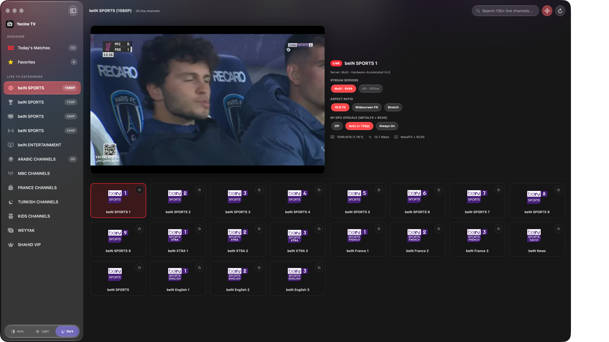
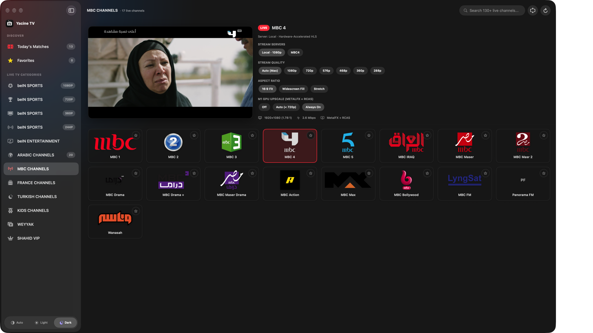
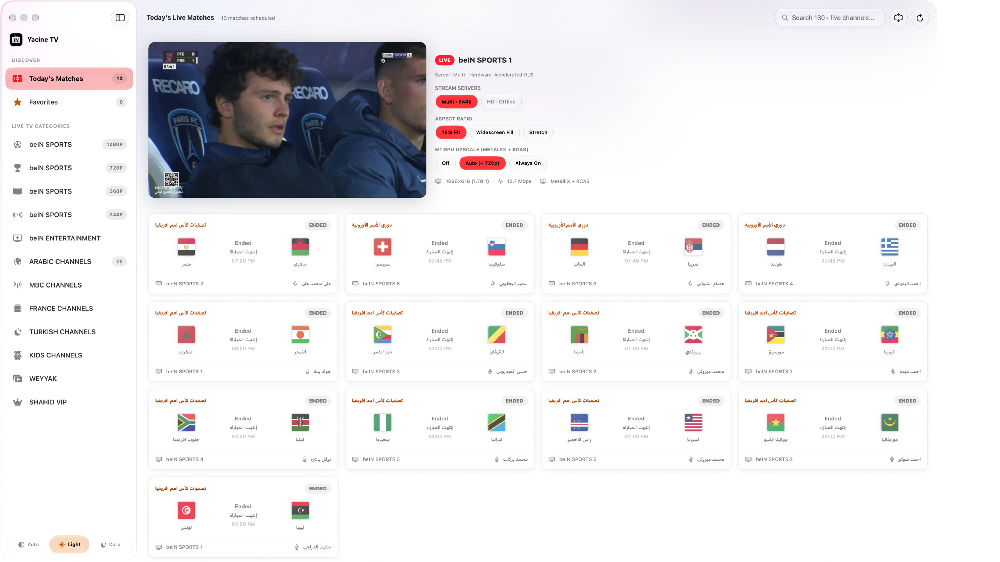
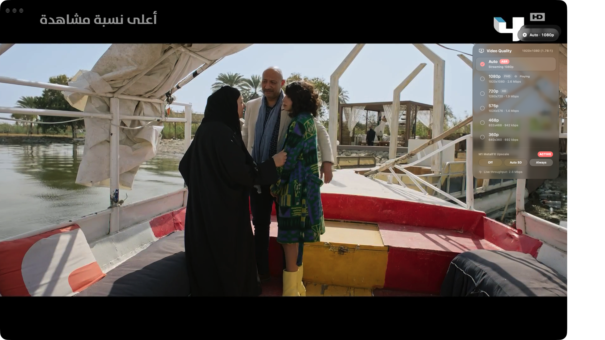

# YacineTV-Desktop

Native desktop client for Yacine TV built with Swift (`main` for macOS, [`windows`](https://github.com/chohaibsoufiane/YacineTV-Desktop/tree/windows) branch for Windows) and a local Python HLS proxy backend.

## Releases

Latest release: **[Yacine TV 3.1 (Build 56)](https://github.com/chohaibsoufiane/YacineTV-Desktop/releases/tag/v3.1)** · [All Releases](https://github.com/chohaibsoufiane/YacineTV-Desktop/releases)

| Platform | Asset | Branch | SHA-256 |
| :--- | :--- | :--- | :--- |
| **macOS** (Apple Silicon `arm64`) | [`YacineTV-3.1-b56-arm64.dmg`](https://github.com/chohaibsoufiane/YacineTV-Desktop/releases/download/v3.1/YacineTV-3.1-b56-arm64.dmg) | `main` | `8c36b6e9a4aa016f8b05e9b1547368cd2f997bc0b6631f3414358b9be0c53d2c` |
| **macOS** (Apple Silicon `.zip`) | [`YacineTV-3.1-b56-arm64.zip`](https://github.com/chohaibsoufiane/YacineTV-Desktop/releases/download/v3.1/YacineTV-3.1-b56-arm64.zip) | `main` | `62a24134b7a599057549a44d0b551d65972f5b64f2a865e626ff21f25d4a0441` |
| **Windows** (`x64` Portable `.zip`) | [`YacineTV-3.1-win64.zip`](https://github.com/chohaibsoufiane/YacineTV-Desktop/releases/download/v3.1/YacineTV-3.1-win64.zip) | [`windows`](https://github.com/chohaibsoufiane/YacineTV-Desktop/tree/windows) | `14b37f8ced1096363051b034ba670608c4d9fd42b41b169f8188efb997208879` |

## Screenshots

| Playback (Dark) | Stream Quality Selection |
| :---: | :---: |
|  |  |

| Match Schedule (Light) | Fullscreen Quality HUD |
| :---: | :---: |
|  |  |

## Overview

- **Native macOS UI**: SwiftUI interface using macOS Liquid Glass (`ConcentricRectangle`, `GlassEffectContainer`), Light/Dark/Auto themes with synced Dock icons, live match schedule (`Upcoming`, `Live`, `Ended`), channel search, and persistent favorites.
- **Hardware Playback & MetalFX**: `AVPlayerView` HLS playback with Picture-in-Picture, `16:9 Fit` / `Widescreen Fill` / `Stretch` modes, fullscreen quality HUD, and GPU-accelerated `MetalFX` spatial upscaling paired with an RCAS Metal fragment shader (`Off`, `Auto (< 720p)`, `Always On`).
- **Local Crypto & HLS Proxy** (`backend/server.py`): Pure standard-library Python server on `127.0.0.1:19485` handling payload decryption (`pk_dec`/`pk_enc`), `wmsAuthSign` token signing (`pk_wma`), multi-host API failover (with optional `YACINE_FIREBASE_*` remote config env vars), concurrent stream probing, master playlist variant selection (`/api/variants`), M3U8 rewriting (`/proxy/m3u8`), and keep-alive segment relaying (`/proxy/seg.ts`).
- **Web Embed Fallback**: `WKWebView` sniffer in `LiveWebPlayerView` captures runtime media URLs and cookies from embedded players to promote streams into `AVPlayer`, alongside a standalone web UI in `ui/`.

## Requirements

- macOS 26 or newer on Apple Silicon (`arm64`)
- Xcode Command Line Tools (`swiftc`)
- Python 3.9+ (standard library only)
- Optional: Apple Icon Composer (`ictool`) if rebuilding `assets/AppIcon.icns` from `assets/yacineTV.icon`

## Build & Run

Prebuilt bundles for macOS (`arm64`) and Windows (`x64`) are available on [Releases](https://github.com/chohaibsoufiane/YacineTV-Desktop/releases).

### macOS (`main`)
Build and install `/Applications/Yacine TV.app` from source:

```zsh
git clone https://github.com/chohaibsoufiane/YacineTV-Desktop.git
cd YacineTV-Desktop
./build.sh
open "/Applications/Yacine TV.app"
```

### Windows ([`windows`](https://github.com/chohaibsoufiane/YacineTV-Desktop/tree/windows) branch)
Build and package portable `build\YacineTV-Windows\YacineTV.exe` with Swift 6 for Windows and WebView2:

```powershell
git clone -b windows https://github.com/chohaibsoufiane/YacineTV-Desktop.git
cd YacineTV-Desktop
.\build.ps1 -Run
```

Run the backend and browser UI standalone on port `19485` (`YACINE_PORT` overrides the port):

```zsh
python3 backend/server.py
```

Regenerate icon assets after editing `assets/yacineTV.icon`:

```zsh
swift scripts/render_icons.swift
```

## Repository Layout

| Path | Description |
| :--- | :--- |
| `macos/YacineTVApp.swift` | Native SwiftUI application, AVKit player, MetalFX shader pipeline, and WKWebView sniffer |
| `backend/server.py` | Local API client, stream prober, M3U8 rewriter, and segment proxy |
| `ui/` | Standalone HTML/CSS/JS client (`hls.min.js`) served at `http://127.0.0.1:19485` |
| `assets/` | App icons (`AppIcon.icns`, Dark/Light variants) and `yacineTV.icon` source |
| `scripts/render_icons.swift` | Iconset and PNG generator via `ictool` and `iconutil` |
| `build.sh` | Compiles, packages, ad-hoc signs, and installs `Yacine TV.app` |

## Disclaimer

Independent macOS client built for personal interoperability testing. Upstream streams, channel names, and logos belong to their respective owners.
